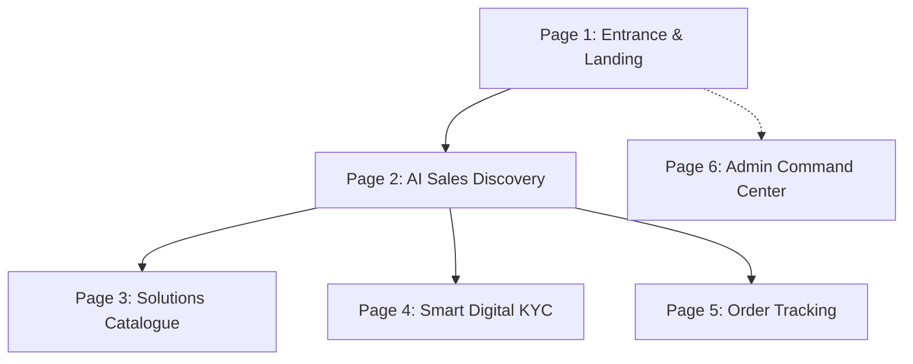

# Airtel Business - Project Udyam Digital: Complete End-to-End Site Specification & Design System

## 1. Executive Vision & Master Architecture
**Airtel Business - Project Udyam Digital** is an enterprise telecommunications commerce platform designed specifically for Indian Micro, Small, and Medium Enterprises (MSMEs). 

It covers the complete user lifecycle from initial landing/entrance to conversational discovery, smart legal verification (DPDP Act 2023 Digital KYC), contract generation, live installation tracking, and backend operations management.

---

## 2. Global Component Standards & Alignment Rules (Strict Consistency)

To ensure every screen looks unified and all interactive components are perfectly aligned:

### A. Button Standards (Strict Unified Tokens)
All buttons across the entire website MUST adhere to these exact styles:

| Button Type | Background Color | Text Color | Border | Border Radius | Padding & Font | Usage |
| :--- | :--- | :--- | :--- | :--- | :--- | :--- |
| **Primary Action** | `#ED1B24` (Airtel Red) | `#FFFFFF` | None | `8px` (`0.5rem`) | `10px 20px`, `Plus Jakarta Sans 800` | "Ask AI Assistant", "Accept Quote", "Dispatch to Chat" |
| **Pill Action** | `#ED1B24` | `#FFFFFF` | None | `9999px` (Full Pill) | `8px 18px`, `Plus Jakarta Sans 700` | Header navigation tabs, active category filters |
| **Secondary Dark** | `#1E293B` (Slate 800) | `#FFFFFF` | None | `8px` (`0.5rem`) | `9px 18px`, `Plus Jakarta Sans 800` | "Download Data" (CSV Export), secondary actions |
| **Accent Orange** | `#EA580C` (Orange-Red) | `#FFFFFF` | None | `8px` (`0.5rem`) | `9px 18px`, `Plus Jakarta Sans 800` | "+ Create New Request" (Admin operations) |
| **Outlined / Subtle** | `#FFFFFF` | `#7F1D1D` | `1px solid #FECACA` | `9999px` (Full Pill) | `6px 14px`, `Plus Jakarta Sans 600` | Inactive filter pills, suggestion chips |
| **Icon Circle** | `#ED1B24` / `#FEF2F2` | `#FFFFFF` / `#ED1B24` | None / `1px solid #FECACA` | `50%` Circle (`40x40px`) | Centered icon | Send button (`➔`), Microphone (`🎤`), Close (`✕`) |

### B. Header & Navigation Alignment Rule
- Every page features a standardized header:
  - **Left**: Lowercase `airtel` badge (`#ED1B24`) + `business` typography (`#0F172A`) + tagline *"Build a Business Together • Project Udyam Digital"*.
  - **Center**: Standard navigation tabs with pill styling.
  - **Right**: User profile chip + Persistent **Role Switcher Widget**:
    `Standard User 👤 ⇄ 🛡️ Administrator` (aligned right, `32px` avatar circles).

### C. Surface & Elevation Rule
- **Backdrop**: Signature vibrant Airtel Red dynamic wave backdrop (`radial-gradient` from `#FF2636` to `#E40000`, `#B30006`, and `#6E0003`) with curved fluid SVG lines.
- **Content Cards**: Elevated white surfaces (`#FFFFFF`) with `1px solid #FECACA` or `#E2E8F0` borders, `16px` to `20px` border radius, and `box-shadow: 0 14px 40px rgba(0,0,0,0.18)`.

---

## 3. The 6 Core Pages (Entrance to Order Tracking & Operations)

---

### Page 1: Entrance & Role Access Portal (Landing Shell)
- **Purpose**: Welcomes MSME enterprise leaders and operational staff to Project Udyam Digital.
- **Key Elements**:
  - Hero header with Airtel Business logo and persistent Role Switcher (`Standard User` vs `Administrator`).
  - Welcome banner highlighting 4 enterprise guarantees:
    1. **High-Speed Uptime**: Guaranteed 99.5% - 99.9% Commercial SLA
    2. **Zero Capex 5G**: On-premise 5G AirFiber and Dedicated Optical Leased Lines
    3. **Zero-Touch e-KYC**: Automated GSTIN & Udyam legal verification
    4. **Rapid Deployment**: 48-hour hardware allocation and certified field technician setup
  - Quick action buttons: `Enter as Customer ➔` and `Open Admin Command Center ➔`.

---

### Page 2: MSME Conversational Discovery & AI Advisor (Chat + Voice)
- **Purpose**: Conversational qualification of enterprise needs (broadband, cloud, leased lines, IoT, security).
- **Layout**: Dual-column desktop.
  - **Left Hero Card**: Airtel Thanks MSME banner *"my business plan. created by me. for me."* with active pack cards:
    - **₹26 / day**: Daily Micro Booster (1.5 GB/day, Spam Shield, Bestseller)
    - **₹160 / 7 days**: Cricket & Media Business Pack (5 GB pooled data, high-priority bandwidth)
    - **₹334 / 30 days**: 30-Day Connect Pack (30 GB data, Static IP, Dual eSIM)
    - **₹2,499 / mo**: Enterprise Growth Suite (300 Mbps Fibre + 4 HD CCTV + Cloud Security)
  - **Right Chat Widget**: Solid Airtel red header with live status, *"Welcome to airtel chat support"*, connected to **Product Specialist Soumya** (Enterprise AI Advisor).
  - **In-Chat Recommendation Carousel**: Algorithmically ranked packages (*Primary Best Match* vs *Value Alternative*) with monthly total, fit reasons, and `Accept Quote & Order ➔` button.
  - **Instant KYC Verification Strip**: Direct document dropzone for instant GSTIN / Udyam OCR extraction and DPDP Act 2023 compliance badge.
  - **Bottom Bar**: Suggestion chips (*"Need Office WiFi for 15 Staff"*, *"Need CCTV for 3 Retail Shops"*, *"Explore 5G AirFiber"*), voice recording microphone, and text input field.

---

### Page 3: Enterprise Solutions Catalogue
- **Purpose**: Structured catalog browsing with strict MSME qualification rules.
- **Layout**:
  - Search input with live query matching.
  - Category Pills: `All`, `Connectivity` (Fibre, Leased Lines), `Cloud & Productivity` (Office 365, Cloud Voice), `Security` (Cloud CCTV), `IoT & Physical`.
  - Solutions Grid Cards:
    - Monthly price in bold red (`₹1,999/mo`), one-time setup fee (`₹1,000`), typical install days (`2 days`), and minimum employee/site constraints.
    - Status Badges: `🔒 Requires GSTIN` or `✅ No GST Needed`, `99.5% Uptime SLA`.
    - Primary Button: `Ask AI Assistant ➔` (redirects query into chat).

---

### Page 4: Smart Digital KYC Verification (DPDP Act 2023)
- **Purpose**: Legally compliant zero-touch authentication via document OCR and live registry matching.
- **Layout**:
  - Upload Card: Drag & drop support for GST Certificate, Udyam Certificate, PAN, Electricity Bill, and Signatory ID.
  - Extracted Fields Table: Legal Name, Trade Name, GSTIN / Udyam Number, Address, PIN Code, State, and Date of Registration.
  - Verification Comparison: Customer form input vs OCR extracted vs Official Mock Registry.
  - Real-Time Status Badges:
    - `✅ VERIFIED ACTIVE` (Green pill: 100% registry match)
    - `⚠️ MANUAL REVIEW` (Amber pill: slight fuzzy address mismatch)
    - `❌ REJECTED` (Red pill: expired or invalid checksum)

---

### Page 5: Post-Discovery Live Order Lifecycle & Tracking
- **Purpose**: Complete visibility over circuit provisioning and field technician activation.
- **Layout Options (Toggleable View)**:
  - **View 1: Vertical Stepper (Stitch Screen 7)**:
    - Green ring nodes connected by active vertical stems:
      1. **Order Confirmed**: Order validated via mock GSTIN/Udyam registry.
      2. **Shipped & Dispatched**: Router CPE & SIM allocated from warehouse.
      3. **Out For Delivery**: Field engineer on-premise installation and optical splicing.
      4. **Delivered & Active**: Commercial circuit live with 99.9% uptime SLA.
      5. **Return / Guarantee Window**: 30-day evaluation guarantee.
  - **View 2: Horizontal Milestone Bar (Image 1)**:
    - Order S00060 banner with 4 nodes (`Pending`, `Confirmed`, `Packed`, `Delivered`) and progress line.
  - **Commercial Contract Box**: Monthly bill (₹2,499), SLA uptime (99.9%), MTTR (< 4 hrs), and billing cycle (Monthly Advance).

---

### Page 6: Operations & Admin Command Center (Stitch Screen 8)
- **Purpose**: B2B telecom operations desk for managing circuit provisioning, technician dispatch, and customer escalations.
- **Layout**:
  - Deep burgundy sidebar (`#7F1D1D`) with navigation: `Orders Management`, `AI Escalations`, `Hardware Inventory`, `SLA Reports`.
  - Top Action Bar: `+ Create New Request` (Orange-red button) and `⬇ Download Data` (CSV Export button).
  - Sub-Tabs:
    1. **Orders Table**:
       - Columns: Order ID & Date, Customer Name, Business Vertical, Telecom Solution, Monthly Recurring Bill, Status, and Action (`Start Shipping` / Live DB Update dropdown).
    2. **AI Escalated Requests & Custom Dispatch Console**:
       - **What the AI sees**: Extracted customer profile (e.g. *Balaji Healthcare & Diagnostics*, 18 Staff, Stated Budget: ₹5,000/mo, Needs: Optical Leased Line, 4 HD CCTV, Static IPv4, SLA Platinum, and raw client transcript).
       - **Custom Bundle Dispatcher**: Admin selects bandwidth tier (300 Mbps, 500 Mbps, 1 Gbps), add-ons (Static IP, 4x CCTV, Cisco/Airtel Dual-WAN Router), custom text proposal, and clicks `🚀 Dispatch to Customer Chat`.
    3. **Regional Hardware Inventory**:
       - Real-time stock counts: Wi-Fi 6 Routers, 5G AirFiber ODUs, Static IP ONT Terminals, 4MP Cloud CCTVs.
    4. **SLA & Performance Reports**:
       - Metrics: Average provisioning speed (1.8 days), Network SLA compliance (99.94%), Instant e-KYC rate (97.6%).
